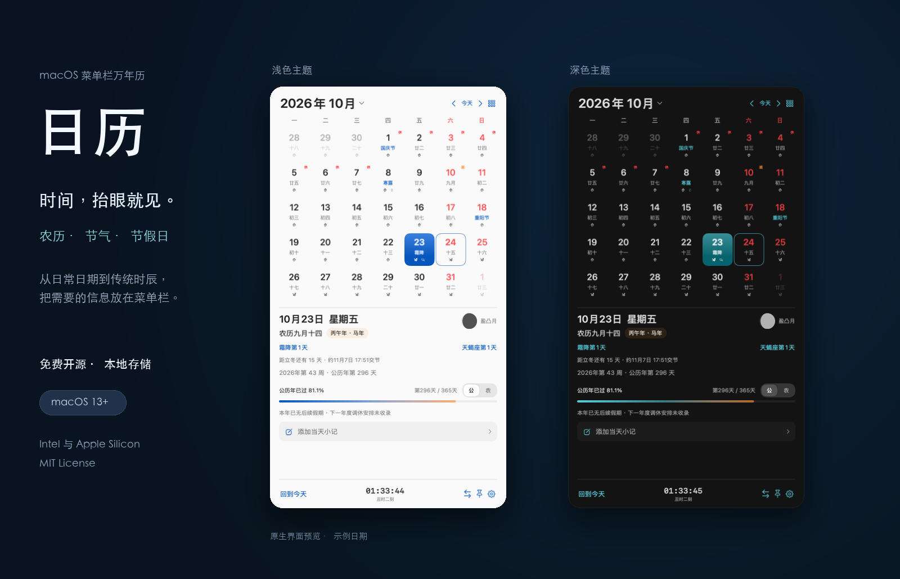
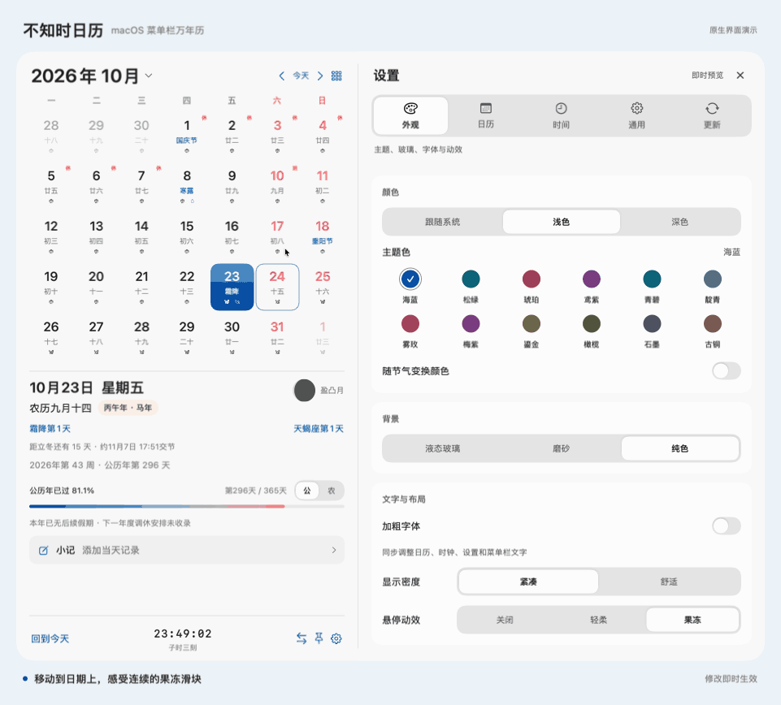

<div align="center">


# 不知时日历

**菜单栏里的农历、节气与每一天。**

免费开源的 macOS 菜单栏万年历 · SwiftUI + AppKit 原生开发

[下载最新版](https://github.com/zbuzhi/menubar-calendar/releases/latest) · [查看版本记录](https://github.com/zbuzhi/menubar-calendar/releases) · [反馈问题](https://github.com/zbuzhi/menubar-calendar/issues)

0.2.1 · macOS 13+ · Apple Silicon / Intel · MIT License

</div>



## 抬眼看时间，点开看日子

不知时日历常驻 Mac 顶部菜单栏，不占 Dock。点击日期，展开月历；农历、节气、放假补班、实时时钟和当天进度，一眼就能看到。设置在月历旁边展开，调整后即时预览。

- **公历与农历**：支持农历日期、闰月、干支年份、生肖和中国传统节日，可查询 1901—2100 年。
- **节气与时令**：查看二十四节气、交节倒计时、节气第几天，以及星座进度、月相和年度进度。
- **节假日与调休**：标记“休 / 班”，支持假期倒计时和本地缓存；未公布年份不猜测放假安排。
- **按你的习惯显示时间**：平滑走秒、传统时辰与刻数，自由组合菜单栏字段、顺序和分隔符，点击或右键复制日期。
- **按你的喜好调整外观**：12 种主题色、浅色 / 深色 / 跟随系统，支持字体加粗、液态玻璃风格与淡彩染色、磨砂和纯色背景，以及果冻悬停动效。
- **保留刚刚好的小功能**：年度缩略图、日期对比、标签小记、图标大小滑杆和显示开关；小记支持多条待办、完成勾选、跨日期筛选和 PDF／Markdown 导出与 JSON 备份。

## 看看怎么用



*动图由应用的实际原生组件生成，使用示例日期、独立演示数据和纯色主题。展示果冻悬停、主题色即时预览、深浅主题切换，以及星座、节气和农历显示开关。*

## 下载与安装

1. 打开 [最新版本](https://github.com/zbuzhi/menubar-calendar/releases/latest)，下载 **`menubar-calendar-版本-universal.zip`**。
2. 解压，将 **不知时日历.app** 拖到“应用程序”文件夹，再打开。
3. 点击顶部菜单栏的日期开始使用；如需开机启动，在“设置 → 通用”中开启。

支持 macOS 13 及以上，通用安装包兼容 Apple Silicon 与 Intel。**macOS 26 及以上支持原生 Liquid Glass**，较旧系统使用兼容材质。

当前免费发行版使用 ad-hoc 签名，尚未经 Apple 公证，首次打开可能出现系统安全提示。安装包和软件更新清单另有 Sparkle Ed25519 签名验证。具体版本信息以 Release 页面为准。

## 常用操作

| 想做什么 | 怎么操作 |
| --- | --- |
| 展开或收起月历 | 点击菜单栏日期，或按 **Control + Option + Space** |
| 查看某一天 | 点击日期，查看农历、节气与年度进度 |
| 切换月份或跳转日期 | 点击左右箭头，或点击年月标题 |
| 调整主题和显示内容 | 点击底部齿轮，设置与月历并排预览 |
| 复制日期与时间 | 点击底部时钟，或右键菜单栏日期选择格式 |
| 小记与待办 | 点击日历下方“小记”，输入自动保存；支持标签、完成勾选和独立置顶 |
| 检查软件新版本 | 设置 → 更新 → 软件更新，也可从菜单栏右键菜单进入 |

## 小记，随手记下就好

- 多条记录、彩色标签与完成勾选，支持简单 Markdown 和常用编辑快捷键。
- 可查看当天、本周、本月或自定义日期范围，按天分组、按标签筛选，支持批量编辑。
- 输入自动保存，可独立置顶、拖动和调整窗口大小；按日期与标签导出 PDF／Markdown，也可备份 JSON。

小记仅保存在本机，升级会保留原有内容。详细的数据结构与迁移约定见 [小记数据协议](docs/NOTES.md)。

## 更新与隐私

**软件更新与节假日数据更新分开管理。** 软件默认每天检查一次，支持关闭自动检查或手动检查，安装前由你确认；节假日数据按需下载并缓存，索引每 7 天检查一次，断网时继续使用内置或已缓存的数据。

无需账号，不含遥测，不上传设置与小记。历法和时间在本机计算，联网仅用于公开的节假日数据与软件更新。节假日数据来自按官方通知整理的 [自维护数据仓库](https://github.com/zbuzhi/calendar-holidays)，属于非官方服务，具体安排以官方通知为准。

星座采用固定日期分界，月相与节气交节时刻为近似计算。详细口径见 [历法与数据说明](docs/DEVELOPMENT.md#历法口径与数据限制)。

## 开发与贡献

欢迎通过 [Issues](https://github.com/zbuzhi/menubar-calendar/issues) 反馈问题或提交改进。

需要 macOS、Swift / Xcode Command Line Tools；首次构建需联网下载 Sparkle，图标会自动生成。

```sh
./scripts/build-app.sh
open dist/不知时日历.app
```

[开发与检查说明](docs/DEVELOPMENT.md) · [软件更新与发布说明](docs/RELEASING.md)

## 开源许可

本项目采用 [MIT License](LICENSE)。Sparkle 与节假日数据的许可声明随应用保留。
